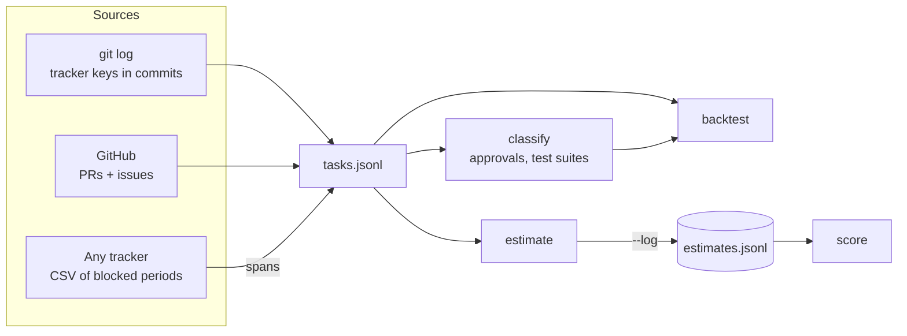

# cc-estimate

**Planning and estimation for AI-assisted teams, from your own delivery history.**

`cc-estimate` answers "how long will this take?" with a range drawn from work your team has
already finished. It counts working time only, tests itself against your history before you
trust it, and scores every estimate you log against what actually happened. It works from plain
git, GitHub, or any tracker whose keys appear in commit messages (Jira, Linear, and others), and
ships as a CLI plus a [Claude Code](https://docs.claude.com/en/docs/claude-code) skill.

## Why

When coding agents write much of the code, implementation stops being the bottleneck. Cycle time
is dominated by review, CI, approvals and waiting on other people. Effort-based estimates miss
that, and self-reported speed-ups are unreliable: in [METR's 2025 study](https://metr.org/blog/2025-07-10-early-2025-ai-experienced-os-dev-study/)
developers felt 20% faster while measuring 19% slower. Measured history is the honest baseline.

## How it works



**1. A task is a unit of delivered work.** That's the commits sharing a tracker key (`ABC-123` or `#123`), or
the pull requests closing the same issue.

**2. Its cycle time counts working hours only.** The clock runs from the first commit to the last
merge. With the git-only source the end is the merge commit that landed the work when the history has
one. In a squash-merged history it is the last commit carrying the key: a commit span, which leaves out
review and merge waiting. A tracker key wins over `#123`; in a squash-merged GitHub history with no
tracker keys, the `(#123)` suffix is the pull request number, so each pull request is its own task. Only Mon–Fri, 09:00–18:00 in your timezone counts. Then three things come out:
- **absence**: days off, from config or per estimate;
- **non-working states**: periods a work item was blocked, on hold or waiting in a queue, taken
  from issue labels or from your tracker's status history;
- **retired process steps**: if you removed a gate (say, a manual QA queue), list its labels and
  history stops charging tasks for it.

**3. An estimate is a range, not a number.** You choose a size bucket, measured in changed lines
including tests: XS <50, S <300, M <1,500, L <5,000, XL ≥5,000. You get the 10th–90th percentile
of cycle time for finished tasks of that size: an 80% interval, in working days.

**4. You can see what the work will need.** Pass the paths you expect to change. If your repo
encodes ownership or test selection in machine-readable files (a CODEOWNERS-style path list, a
script that maps paths to test suites), the estimate lists the approvals and suites the change
will trigger. This is context; it doesn't change the number.

**5. It proves itself before you rely on it.** `backtest` replays your history:
- Each task is estimated using only tasks that had already finished when it started.
- The oldest tasks only serve as history. Of the rest, the most recent 20% (at least 10) are
  locked for scoring and never used for tuning.
- Tasks that started near the end of the data are dropped, since only their fast siblings have
  finished.

The `size` rows assume you name the final size before you start, so they are a best case. Logged
estimates (`--log`, then `score`) measure what you actually achieve. A backtest needs at least 40
finished tasks; below that it says so.

Every method competes against plain baselines (repo median, trailing 30 days, same author) on
three numbers:
- **coverage**: how often the actual landed in the interval;
- **interval width**;
- **[Winkler score](https://otexts.com/fpp3/toolbox.html#sec-distaccuracy)**: width plus a penalty for misses.
  Lower is better.

`estimate` always prints the size-blind range next to the size range. Trust the size range only
where the backtest shows it winning on your repo.

**6. It keeps score.** Every logged estimate is later compared with the real cycle time. `score`
reports your coverage, and whether your size call beat a size-blind interval.

## Quick start

Requires Python 3.10+. No dependencies. The GitHub source also needs an authenticated
[`gh`](https://cli.github.com/).

```bash
pip install git+https://github.com/Nachox07/cc-estimate
cc-estimate init                             # writes cc-estimate.json; set repo, source, timezone
```

**From git only** (Jira, Linear or any key in commit messages; set `"source": "git"`):

```bash
cc-estimate git-tasks --repo-dir . --branch origin/main --since "180 days ago" --config cc-estimate.json --out data/repo.tasks.jsonl
```

**From GitHub** (pull requests and the issues they close):

```bash
cc-estimate fetch --repo org/repo --since 2026-04-01 --until 2026-10-01 --config cc-estimate.json --out data/repo.jsonl
cc-estimate links --repo org/repo --since 2026-04-01 --until 2026-10-01 --config cc-estimate.json --out data/repo.links.jsonl
cc-estimate tasks --prs data/repo.jsonl --links data/repo.links.jsonl --config cc-estimate.json --out data/repo.tasks.jsonl
```

**Then:**

```bash
cc-estimate spans    --tasks data/repo.tasks.jsonl --csv blocked.csv --out data/repo.tasks.jsonl   # optional
cc-estimate backtest --in data/repo.tasks.jsonl --config cc-estimate.json
cc-estimate estimate --size M --issue 123 --paths src/api/ --log --config cc-estimate.json --tasks data/repo.tasks.jsonl
cc-estimate score    --config cc-estimate.json --tasks data/repo.tasks.jsonl
```

**In Claude Code:**

```
/plugin install cc-estimate --marketplace Nachox07/cc-estimate
```

On Claude Code versions without `--marketplace`, run `/plugin marketplace add Nachox07/cc-estimate`,
then `/plugin install cc-estimate@cc-estimate`. The plugin's skill calls the `cc-estimate` command,
so install the CLI too (`pipx install git+https://github.com/Nachox07/cc-estimate`).

## Adapting it to your stack

Everything downstream reads one file format, `tasks.jsonl`, one JSON object per task:

| Field | Meaning |
|---|---|
| `id` | task key (`ABC-123`, issue number) |
| `title`, `labels` | as known when the task started |
| `author` | who delivered it; used only for that person's own estimates |
| `start`, `end` | ISO-8601: first commit; last merge (or last commit, see above) |
| `lines` | changed lines, tests and docs included |
| `excluded` | `{"blocked": [[start, end], …], …}`: non-working periods |

A new source is any script that writes those rows: a Jira or Linear API export, Azure DevOps,
GitLab. The `spans` command already accepts a CSV of `key,group,start,end` from any tracker's
status history. Specs, PRDs and ADRs fit the same way: give the task the key the document is
filed under, and link the commits to it.

Repo-specific behaviour lives in `cc-estimate.json`: bots to ignore, timezone, absence, labels
that mean "not working", and the `classifier` hooks for approval and test-suite rules. See
[`config.example.json`](cc_estimate/config.example.json). `default_branch` (default `main`) names the branch work lands on.
`git.key_regex` takes one pattern or a list tried in order; pass `--config` to `git-tasks` to use it.
`classifier.default_branch` is different: the git ref the classifier reads paths from, such as
`origin/main`.

## Privacy

Delivery history contains your colleagues' activity. The raw files hold their logins, which is why
`data/`, the cache and `cc-estimate.json` are git-ignored. No command prints another person's login
or numbers, or a PR title (titles can name people). `summary` prints totals per size bucket, never a
single PR, and leaves out the numbers of any bucket with fewer than five PRs or three authors (so
does `backtest`); `ci` adds its results to the history file and prints only a count. Per-person data
is used only to log and score your own estimates. The test suite runs `tasks`, `spans`, `backtest`,
`estimate`, `summary` and `git-tasks` on a three-person fixture and fails if another login appears.
`fetch` writes only to a file. Cycle time mostly measures waiting, not effort, so don't use it to
compare people.

## Status and roadmap

v0.1.1. Planned work:
- Jira and Linear API sources.
- Splitting cycle time into active work and waiting.
- Similar-task retrieval to show the closest finished tasks beside the range.
- A split / keep / merge check for tasks that are too big or too small.

## Credits

Interval scoring as in Nixtla `utilsforecast` and Darts. The idea that change size predicts review
effort on AI-written PRs comes from arXiv:2601.00753. Inspired by Monte Carlo forecasting for agile
teams. MIT licence.
