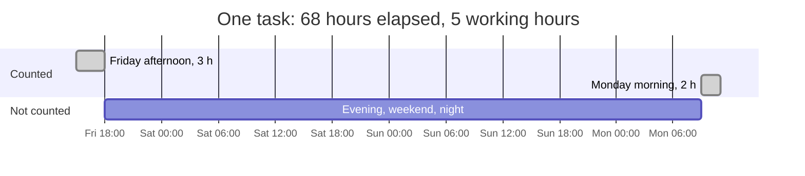
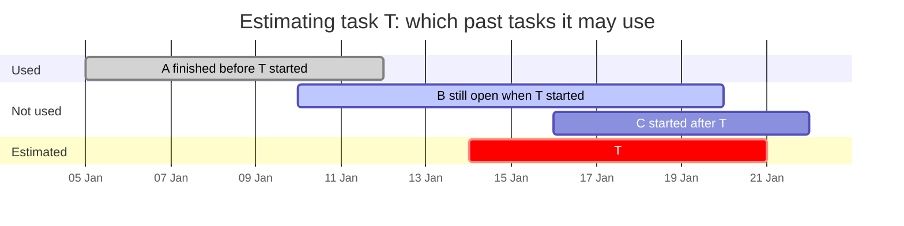
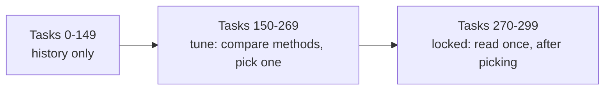
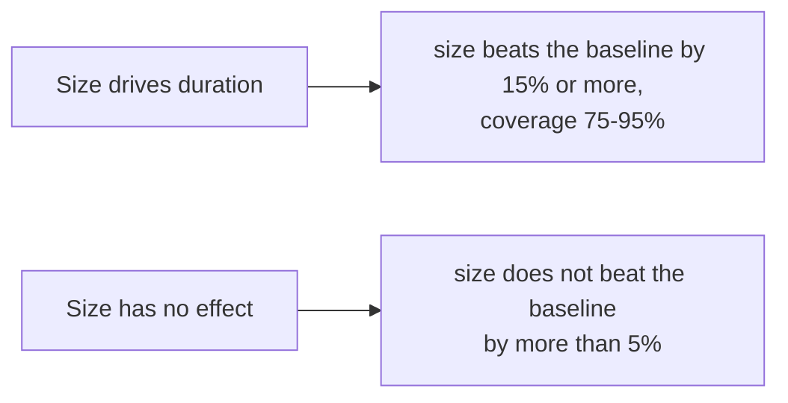
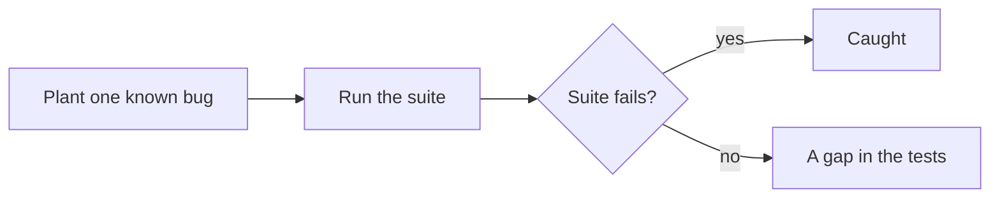

# How cc-estimate works

cc-estimate answers one question: **how long will this task take here?** It answers from your
own repository's history, as a range, and keeps score of how good those ranges turn out to be.

Every output below comes from a made-up history of 300 tasks by three people, drawn by
`cc-estimate simulate --scenario size-matters`. Recreate it with:

```bash
python3 examples/sample_history.py data/sample.tasks.jsonl
```

## The pipeline

1. **Build tasks.** One task is one piece of work: a tracker key in commit messages (`git-tasks`),
   or the pull requests that close the same issue (`fetch`, `links`, `tasks`). Bots, release
   branch cherry-picks and automation are dropped.
2. **Measure cycle time in working hours.** From the first commit (or the PR opening, if earlier)
   to the last merge, counting only Monday to Friday, 09:00–18:00 in your timezone. Absence days
   and blocked periods are subtracted.
3. **Backtest.** Replay the history in order. Each past task is estimated using only tasks that
   had finished before it started, and every method is scored against plain baselines.
4. **Estimate.** For a new task of a given size, print the 80% range of similar finished tasks,
   next to the range you would get without a size.
5. **Log and score.** `--log` records the estimate. `score` later compares it with what happened.

For example, a task whose first commit lands on Friday at 15:00 and whose PR merges on Monday at
11:00 took 68 hours on the clock but 5 working hours:



A task file is one JSON object per line:

```json
{"id": "SIM-2", "title": "feat: add", "author": "user-c", "labels": [], "start": "2023-01-03T09:18:00+00:00", "end": "2023-01-19T16:45:41+00:00", "lines": 13038, "code_lines": 8538, "test_lines": 4448, "doc_lines": 52, "excluded": {}}
```

## Reading `backtest`

The backtest walks the history in start order. For each task it builds the range a method would
have given that day, then checks where the real duration landed. Only tasks that had already
finished count as history:



The tasks are then split in three, in time order:



```text
dropped 0 tasks starting after 2024-01-22 (right-censoring)
tasks with blocked or absence time removed: 0
test-heavy tasks (tests over 3x product code): 48
tasks: 300  tune: [150,270)  locked: [270,300)  level=0.8  locked from 2023-12-06
  XS n=  63  business hours p10=   1.7 p50=   2.7 p90=   4.4
  S  n=  51  business hours p10=   3.2 p50=   5.1 p90=   9.8
  M  n=  60  business hours p10=   9.4 p50=  17.3 p90=  36.4
  L  n=  61  business hours p10=  25.4 p50=  52.2 p90= 109.6
  XL n=  65  business hours p10=  63.2 p50= 145.6 p90= 273.8
```

The first 150 tasks are history only. Tasks 150–269 are the **tune** slice, where you may compare
and pick methods. The last 30 are **locked**: look at them once, after choosing. The size table
shows the spread inside each size (size is changed product-code lines, tests and docs not counted:
XS under 50, S under 300, M under 1,500, L under 5,000). The test-heavy count is the tasks whose test
lines exceed three times their product-code lines; they are sized by their code, not their tests. A size with fewer than five tasks, or fewer than three people, shows only its count.

```text
== LOCKED · all tasks ==
  method                         n  cover  width_h medAE_h  winkler fallbk
  baseline: repo                30   0.83    162.2    17.8    164.1   0.00
  baseline: trailing 30d        30   0.80    166.6    23.4    191.1   0.00
  baseline: same author         30   0.83    158.0    20.3    163.5   0.00
  kind+epic                     30   0.87    168.6    19.3    167.1   0.00
  size                          30   0.80     16.3     2.2     49.9   0.00
  size+kind                     30   0.77     16.1     3.9     51.7   0.00
  size+kind+epic                30   0.77     16.1     3.9     51.7   0.00
  size+kind x pace              30   0.80     16.5     3.9     58.7   0.00
  size+team load                30   0.77     19.4     2.2     55.4   0.00
```

- **cover**: how often the real duration landed inside the range. Aim for about 0.80.
- **width_h**: the median range width in working hours. Narrower is more useful.
- **medAE_h**: the median distance between the middle of the range and the real duration.
- **winkler**: width plus a penalty for each hour a miss falls outside the range. One number for
  "narrow and right"; lower is better.
- **fallbk**: how often a method had too few matching tasks and fell back to a simpler one.

Here `size` cuts the Winkler score of every baseline by about two thirds at similar coverage, so on this
history the size is worth giving. On your history it may not be; the table tells you. Methods
that need `classify` output (approvals, test suites) only appear when you pass `--profiles`.

## Reading `estimate`

```text
$ cc-estimate estimate --size L --text "add CSV export"
Size L: 61 finished tasks in history (data up to 2024-02-12).
80% range: 25.4-109.6 work hours (2.8-12.2 working days), median 52.2 h (5.8 d).
Without a size: 2.6-162.7 h.
```

Read it as: eight in ten L tasks here finished in 2.8 to 12.2 working days. "Without a size" is the
range for any task; the gap between the two lines is what the size buys you. When a size has fewer
than five finished tasks, `estimate` says "Not enough history for size L" and prints only the
size-blind range. Tasks that started in the last 21 days are left out, because only the quick
ones among them have finished.

With a `classifier` in the config, `--paths` adds what the change will go through, for example
which approval groups and test suites the paths trigger. That is context; it does not change the
range.

## Coding and waiting

Most of a task's cycle time is usually waiting for review, and the size of the change says little
about how long that takes. So when the history knows the moment each pull request was marked ready
for review (`ready_at`), `estimate` also prints two ranges next to the total:

```text
$ cc-estimate estimate --size M
...
Coding, size M: 0.9-1.7 work hours (0.1-0.2 working days), median 1.1 h (0.1 d); 148 tasks.
Waiting for review, any queue: 1.4-11.6 work hours (0.2-1.3 working days), median 4.4 h (0.5 d); 899 waits, 51 not merged yet or closed unmerged.
  Pass --queue N (open PRs waiting on your planned reviewers) to fit it to today's queue.

$ cc-estimate estimate --size M --queue 6
Waiting for review, with 6 PRs already waiting on your reviewers (high queue on this repo): 3.8-16.1 work hours ...
```

(Made-up history from `cc-estimate simulate --scenario wait-dominates`; `backtest --in sim/tasks.jsonl` finds
`sim/queue.jsonl` beside it.)

**Two clocks.** *Coding* is the working time from the first commit to ready-for-review, by size, minus
the author's days off and blocked spans, like the total. *Waiting* is the working time from ready to the
merge, minus public holidays only (the `*` rows of `absence`). The author's calendar and blocked spans do
not stop a reviewer's clock. So coding and waiting no longer add up to the total whenever someone was off.

**The reviewer queue** is GitHub's own meaning of "review requested", per reviewer: a pull request is in
reviewer X's queue from X's request until X submits a review, the request is removed, or the PR merges
or closes, whichever comes first. Drafts are not in it. Bot-authored PRs are (dependabot PRs with
CODEOWNERS requests sit in real queues), so they count in the queue though not in the waiting curve. A
PR asking several of the reviewers you plan to ask counts once. Users and teams are separate keys,
as in GitHub's `user-review-requested:X` and `team-review-requested:org/team` (plain `review-requested:X`
also matches a user through their teams), which is what the skill counts today for `--queue N`; a test
checks the code against that meaning on one fixture. For a team the data cannot tell who is a member, so
a team's request ends at any human's review: its queue is undercounted. Review requests that land within
five minutes after a PR's own ready moment count as made at that ready (CODEOWNERS asks about a second
after a PR opens). Re-requests after a review start a new entry.

For history, the queue each past PR faced is counted from `fetch-queue`'s file of every PR (open and
closed-unmerged too), using only what was known at the instant: requests made by then, reviews and merges
not yet happened. A PR with no reviewer named yet gets the count of all ready, unmerged PRs. The backtest's
`queue` rows use the queue when the task *starts* (for the reviewers it went on to ask: a planner's
stand-in for "the reviewers I plan to ask"), which is all a planner knows then. The `... at ready` rows use
the queue when the PR goes ready and are a re-estimate made at that moment, so they score sharper; the skill
tells the agent to re-run the wait estimate with a fresh `--queue` when the PR goes ready.

**Waiting is estimated by Kaplan-Meier, from pull requests, not tasks.** One population, one clock: every
PR in the queue file that became ready on or after the tasks file's first start. A merged PR is a finished
wait. A PR ready and not yet closed is still waiting, so it stays in the count, censored at the moment of
the estimate; dropping it would keep only the waits that ended and make slow ones look rare. A PR closed
without merging is censored at its close time. Censoring is not independent of the wait either way
(abandoned PRs tend to have waited long), but dropping them at close would make a PR's part in the curve
change as time moves on, and read faster than the truth; censoring at the close is time-consistent, so the
backtest at a task's start and the estimate today use one rule. Bot-authored PRs are not in the curve. The
queue file may start earlier than the tasks file only so PRs already waiting are counted in a task's queue; the
curve starts at the tasks file's first start, because an old PR still open would be a survivor with no
finished siblings from its period. Task rows keep `wait_y` for the coding split and the tables.
When too many PRs are still open to say where the top of the range is, it prints `+`: at least that.

`--queue N` keeps only PRs whose own queue fell in the same third (low, middle, high) as N. The thirds
are fitted on the queues of the PRs in the curve: all of them in `estimate`, which has no unseen slice to
protect; only those ready before the locked slice begins in the backtest, so the locked slice stays unseen.

`backtest` scores the same split. `CODING`: repo baseline, same author, size. `WAIT`: those, plus
`queue`, `queue at ready` and `size+queue` on task rows, and `km wait`, `km wait+queue` and
`km wait+queue at ready`, the ranges `estimate` prints, rebuilt for each scored task from the PRs as known
at its start (waits finished by then, PRs ready and still open then, censored at the start). On the sample,
`km wait` is about the plain baseline (there is little censoring to correct), the queue counted at the start
cuts the Winkler score by about a sixth and the queue at ready by about a quarter.
`--log` stores the coding and waiting ranges and the queue you passed (a quantile the data never reached,
such as the top of a range with many PRs still open, is stored as null), and `score` reports how often the
real coding and waiting time landed inside them, leaving out and counting the ranges with a null end. Only counts of waiting PRs are printed, never reviewer
names.

## Logging and scoring

`estimate --log --issue 123` appends the range to `data/estimates.jsonl` with your login. After the
work merges, `score` finds its real cycle time and reports how many of your estimates landed in
their range, and whether your size call did better than the size-blind range. It only ever shows
your own estimates.

## How it is tested

- **Unit tests** pin each rule with small hand-made inputs: working hours across weekends, daylight
  saving and absence; blocked time counted once when spans overlap; grouping PRs into tasks; where
  a git-only task ends; the coverage, width and Winkler numbers worked out by hand.
- **No look-ahead.** Two tests check that an estimate cannot see the future: changing the outcome of
  any task that had not finished when the estimated one started leaves the estimate unchanged.
- **Signal and no signal.** On generated histories where size drives duration, `size` must beat the
  repo baseline's Winkler score by at least 15% and cover 75–95%, across five random seeds. On
  histories where size has no effect, `size` must not beat the baseline by more than 5%. A method
  that always wins, or never does, fails one of the two.
- **Known truth.** `cc-estimate simulate --scenario <name> --seed <n> --out <dir>` writes a made-up
  `tasks.jsonl` and a `truth.json` stating the model the durations were drawn from. Durations are
  drawn in working hours and placed on the clock at non-round minutes, so they do not pile up at 0 or 9
  hours. The scenario tests read the last tasks (the locked slice) over seeds 7-11 and check a band, not
  an exact number: in `size-matters` the size rows cover 70-90% and beat the baseline's Winkler score by
  at least 15%; in `null` they land within 5% of it; in `test-heavy` each test-heavy task is sized by its
  product code and flagged, and no other task is; in `thin` (27 S and 3 L tasks) `backtest` refuses and
  `estimate` gives a size range for S and the size-blind range for L. In `wait-dominates` (PRs opened
  every few hours, two reviewer teams, waiting driven by the queue) coding follows size, waiting
  follows the queue and not size, and the total, mostly waiting, is no better with size than without:
  on the locked slice `queue` beats the baseline by at least 15% on `WAIT`, `size` does not beat it
  by more than 5% there, and `size` does not beat it by more than 15% on the total.
- **Privacy.** Every command that runs offline is run on a three-person history and fails if
  another person's login appears. Small groups are hidden in `summary` and `backtest`.
- **Mutation probe.** `python3 tests/mutation_probe.py` plants 37 known bugs one at a time (a
  look-ahead leak, a dropped miss penalty, weekends counted as work, the wrong range level, and so
  on) and checks that the suite fails for each. A last, harmless change must pass, which shows the
  probe is not failing everything. All 37 are caught.
- **CI** runs the suite on Python 3.10, 3.12 and 3.13, installs the package from scratch, runs
  `init` and `git-tasks` from outside the source tree, and checks the plugin manifests.

Each generated world has a pass rule the other world would fail:



The mutation probe checks the tests themselves:



## Limits

- Cycle time mostly measures waiting (review, CI, queues), not effort. It is not a measure of a
  person, and the tool never compares people.
- The `size` rows in the backtest use the final size, as if you had named it perfectly at the
  start. Logged estimates measure how well you really name sizes.
- In a squash-merged history without merge commits, a git-only task ends at its last commit, which
  leaves out the wait for review.
- Size counts product-code lines only. Tests and docs are carried beside it; a task with tests over
  3x its code is flagged test-heavy. Task files from before this split have no `code_lines`; they
  load, sized by total lines, with a note on stderr.
