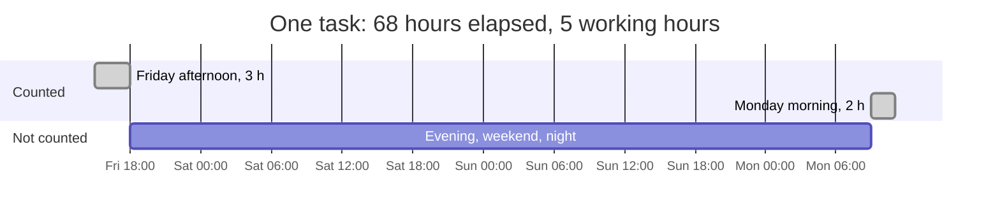
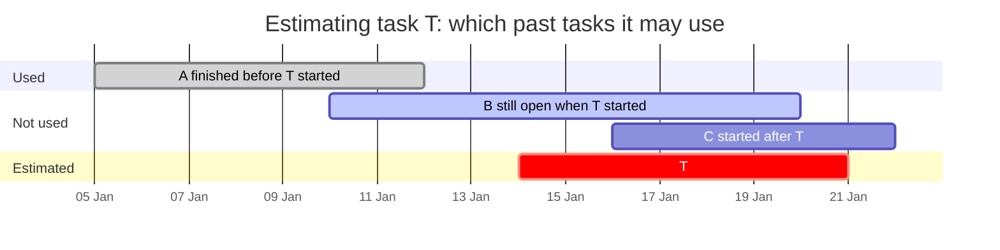
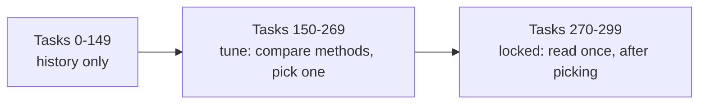
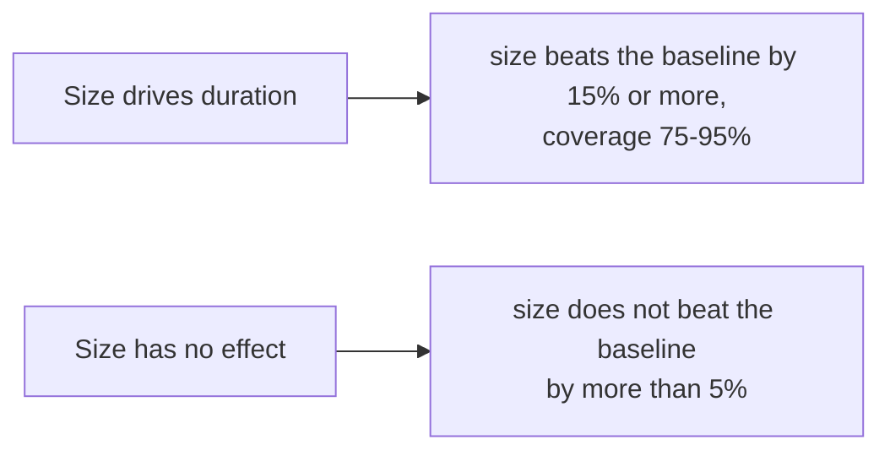
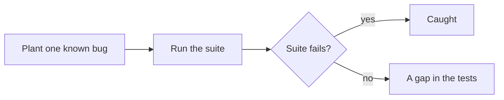

# How cc-estimate works

cc-estimate answers one question: **how long will this task take here?** It answers from your
own repository's history, as a range, and keeps score of how good those ranges turn out to be.

Every output below comes from a made-up history of 300 tasks by three people, drawn by
`cc-estimate simulate --scenario size-matters`. Recreate it with:

```bash
python3 examples/sample_history.py data/sample.tasks.jsonl
```

## The pipeline

1. **Build tasks.** One task is one piece of work: a tracker key in commit messages (`git-tasks`),
   or the pull requests that close the same issue (`fetch`, `links`, `tasks`). Bots, release
   branch cherry-picks and automation are dropped.
2. **Measure cycle time in working hours.** From the first commit (or the PR opening, if earlier)
   to the last merge, counting only Monday to Friday, 09:00–18:00 in your timezone. Absence days
   and blocked periods are subtracted.
3. **Backtest.** Replay the history in order. Each past task is estimated using only tasks that
   had finished before it started, and every method is scored against plain baselines.
4. **Estimate.** For a new task of a given size, print the 80% range of similar finished tasks,
   next to the range you would get without a size.
5. **Log and score.** `--log` records the estimate. `score` later compares it with what happened.

For example, a task whose first commit lands on Friday at 15:00 and whose PR merges on Monday at
11:00 took 68 hours on the clock but 5 working hours:



A task file is one JSON object per line:

```json
{"id": "SIM-2", "title": "feat: add", "author": "user-c", "labels": [], "start": "2023-01-03T09:18:00+00:00", "end": "2023-01-19T16:45:41+00:00", "lines": 13038, "code_lines": 8538, "test_lines": 4448, "doc_lines": 52, "excluded": {}}
```

## Reading `backtest`

The backtest walks the history in start order. For each task it builds the range a method would
have given that day, then checks where the real duration landed. Only tasks that had already
finished count as history:



The tasks are then split in three, in time order:



```text
dropped 0 tasks starting after 2024-01-22 (right-censoring)
tasks with blocked or absence time removed: 0
test-heavy tasks (tests over 3x product code): 48
tasks: 300  tune: [150,270)  locked: [270,300)  level=0.8  locked from 2023-12-06
  XS n=  63  business hours p10=   1.7 p50=   2.7 p90=   4.4
  S  n=  51  business hours p10=   3.2 p50=   5.1 p90=   9.8
  M  n=  60  business hours p10=   9.4 p50=  17.3 p90=  36.4
  L  n=  61  business hours p10=  25.4 p50=  52.2 p90= 109.6
  XL n=  65  business hours p10=  63.2 p50= 145.6 p90= 273.8
```

The first 150 tasks are history only. Tasks 150–269 are the **tune** slice, where you may compare
and pick methods. The last 30 are **locked**: look at them once, after choosing. The size table
shows the spread inside each size (size is changed product-code lines, tests and docs not counted:
XS under 50, S under 300, M under 1,500, L under 5,000). The test-heavy count is the tasks whose test
lines exceed three times their product-code lines; they are sized by their code, not their tests. A size with fewer than five tasks, or fewer than three people, shows only its count.

```text
== LOCKED · all tasks ==
  method                         n  cover  width_h medAE_h  winkler fallbk
  baseline: repo                30   0.83    162.2    17.8    164.1   0.00
  baseline: trailing 30d        30   0.80    166.6    23.4    191.1   0.00
  baseline: same author         30   0.83    158.0    20.3    163.5   0.00
  kind+epic                     30   0.87    168.6    19.3    167.1   0.00
  size                          30   0.80     16.3     2.2     49.9   0.00
  size+kind                     30   0.77     16.1     3.9     51.7   0.00
  size+kind+epic                30   0.77     16.1     3.9     51.7   0.00
  size+kind x pace              30   0.80     16.5     3.9     58.7   0.00
  size+team load                30   0.77     19.4     2.2     55.4   0.00
```

- **cover**: how often the real duration landed inside the range. Aim for about 0.80.
- **width_h**: the median range width in working hours. Narrower is more useful.
- **medAE_h**: the median distance between the middle of the range and the real duration.
- **winkler**: width plus a penalty for each hour a miss falls outside the range. One number for
  "narrow and right"; lower is better.
- **fallbk**: how often a method had too few matching tasks and fell back to a simpler one.

Here `size` cuts the Winkler score of every baseline by about two thirds at similar coverage, so on this
history the size is worth giving. On your history it may not be; the table tells you. Methods
that need `classify` output (approvals, test suites) only appear when you pass `--profiles`.

## Reading `estimate`

```text
$ cc-estimate estimate --size L --text "add CSV export"
Size L: 61 finished tasks in history (data up to 2024-02-12).
80% range: 25.4-109.6 work hours (2.8-12.2 working days), median 52.2 h (5.8 d).
Without a size: 2.6-162.7 h.
```

Read it as: eight in ten L tasks here finished in 2.8 to 12.2 working days. "Without a size" is the
range for any task; the gap between the two lines is what the size buys you. When a size has fewer
than five finished tasks, `estimate` says "Not enough history for size L" and prints only the
size-blind range. Tasks that started in the last 21 days are left out, because only the quick
ones among them have finished.

With a `classifier` in the config, `--paths` adds what the change will go through, for example
which approval groups and test suites the paths trigger. That is context; it does not change the
range.

## Reading `advise`

```text
$ cc-estimate advise --plan sim/plan.jsonl
History: 322 finished tasks (data up to 2024-02-12).
Width of the 80% range by size, in work hours:
  XS n=56  width 3.4
  S  n=59  width 2.8  x0.8 vs the bucket below
  M  n=56  width 4.3  x1.6 vs the bucket below
  L  n=96  width 4.1  x0.9 vs the bucket below
  XL n=55  width 13.0  x3.2 vs the bucket below
Break point by size: XL.
No area data in this history (pass --profiles from classify): the advice uses size only.
Past splits: 12 past splits at or above XL took a median of 8.0 work hours in total, against 21.0 for single tasks of the same size.

big (XL): Split. XL reaches the size break point (XL), where the 80% range gets much wider.
  Slices, in dependency order. Ordered by the layer rule (matching path patterns): shared code, then services, then UI, then tests, then docs.
  1. shared code: 2 file(s), size L: 4.9-9.0 work hours (0.5-1.0 working days), median 6.9 h, n=96
  2. services: 2 file(s), size L: 4.9-9.0 work hours (0.5-1.0 working days), median 6.9 h, n=96
  3. UI: 2 file(s), size L: 4.9-9.0 work hours (0.5-1.0 working days), median 6.9 h, n=96
  4. tests: 1 file(s), size XS: 3.3-6.7 work hours (0.4-0.7 working days), median 4.3 h, n=56
  5. docs: 1 file(s), size XS: 3.3-6.7 work hours (0.4-0.7 working days), median 4.3 h, n=56
  Slice sizes assume product-code lines in proportion to code files; the tool cannot see lines per file.

mid (L): Keep. L is below the break point XL.
```

Read it from the top. The table is the width of the 80% range for each size, with the ratio to the
size below. The break point is the first size whose ratio is above 2.0: here XL, where the range is
3.2 times as wide as at L. A task at that size or above is a candidate for splitting; the "Past
splits" line says whether splitting has paid off in this history. A split is several tasks that
close one parent issue; the line compares the total time of such sets with single tasks of the
same combined size.

The advice stops at No advice when:

- no size has a ratio above 2.0 ("no size bucket has an 80% range more than twice as wide");
- fewer than 20 finished tasks lie on either side of the break ("too thin");
- past splits were not faster in total, or cannot be found (no parent issues, as in the git-only
  source), so the claim cannot be checked.

Slices are ordered by the layer rule: docs and tests are recognised first, then each path is matched
against the layer patterns (`advise.layers` in the config, or the defaults), and the layers run
shared code, services, other code, UI, tests, docs. Each slice's size is a share of the history's
typical product-code lines for the task's size, in proportion to its code files. The tool sees file
counts, not lines, so treat slice sizes as a guide. Areas are the first path segment unless the
classifier's `area_depth` says otherwise; with `--profiles` from `classify` the break is also computed
by number of areas, and without it the output says it used size only. A bucket with fewer than five
tasks or three authors prints counts only. Merge needs no history: two XS or S tasks that touch the
same area.

## Logging and scoring

`estimate --log --issue 123` appends the range to `data/estimates.jsonl` with your login. After the
work merges, `score` finds its real cycle time and reports how many of your estimates landed in
their range, and whether your size call did better than the size-blind range. It only ever shows
your own estimates.

## How it is tested

- **Unit tests** pin each rule with small hand-made inputs: working hours across weekends, daylight
  saving and absence; blocked time counted once when spans overlap; grouping PRs into tasks; where
  a git-only task ends; the coverage, width and Winkler numbers worked out by hand.
- **No look-ahead.** Two tests check that an estimate cannot see the future: changing the outcome of
  any task that had not finished when the estimated one started leaves the estimate unchanged.
- **Signal and no signal.** On generated histories where size drives duration, `size` must beat the
  repo baseline's Winkler score by at least 15% and cover 75–95%, across five random seeds. On
  histories where size has no effect, `size` must not beat the baseline by more than 5%. A method
  that always wins, or never does, fails one of the two.
- **Known truth.** `cc-estimate simulate --scenario <name> --seed <n> --out <dir>` writes a made-up
  `tasks.jsonl` and a `truth.json` stating the model the durations were drawn from. Durations are
  drawn in working hours and placed on the clock at non-round minutes, so they do not pile up at 0 or 9
  hours. The scenario tests read the last tasks (the locked slice) over seeds 7-11 and check a band, not
  an exact number: in `size-matters` the size rows cover 70-90% and beat the baseline's Winkler score by
  at least 15%; in `null` they land within 5% of it; in `test-heavy` each test-heavy task is sized by its
  product code and flagged, and no other task is; in `thin` (27 S and 3 L tasks) `backtest` refuses and
  `estimate` gives a size range for S and the size-blind range for L. Five advisor scenarios check
  `advise`: `break-point` (XL named as the break, only the XL task split, slices cover every file and
  each is below the break), `no-break`, `slow-splits` and `thin-advisor` (each gives no advice, for its
  own stated reason) and `merge-keep` (only the same-area pair merges).
- **Privacy.** Every command that runs offline is run on a three-person history and fails if
  another person's login appears. Small groups are hidden in `summary` and `backtest`.
- **Mutation probe.** `python3 tests/mutation_probe.py` plants known bugs one at a time (a
  look-ahead leak, a dropped miss penalty, weekends counted as work, the wrong range level, and so
  on) and checks that the suite fails for each. A last, harmless change must pass, which shows the
  probe is not failing everything. All are caught.
- **CI** runs the suite on Python 3.10, 3.12 and 3.13, installs the package from scratch, runs
  `init` and `git-tasks` from outside the source tree, and checks the plugin manifests.

Each generated world has a pass rule the other world would fail:



The mutation probe checks the tests themselves:



## Limits

- Cycle time mostly measures waiting (review, CI, queues), not effort. It is not a measure of a
  person, and the tool never compares people.
- The `size` rows in the backtest use the final size, as if you had named it perfectly at the
  start. Logged estimates measure how well you really name sizes.
- In a squash-merged history without merge commits, a git-only task ends at its last commit, which
  leaves out the wait for review.
- Size counts product-code lines only. Tests and docs are carried beside it; a task with tests over
  3x its code is flagged test-heavy. Task files from before this split have no `code_lines`; they
  load, sized by total lines, with a note on stderr.
