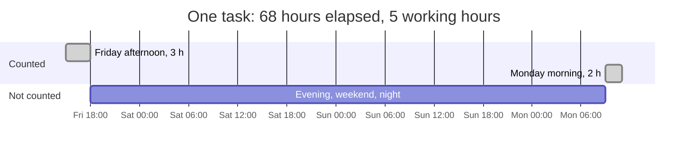
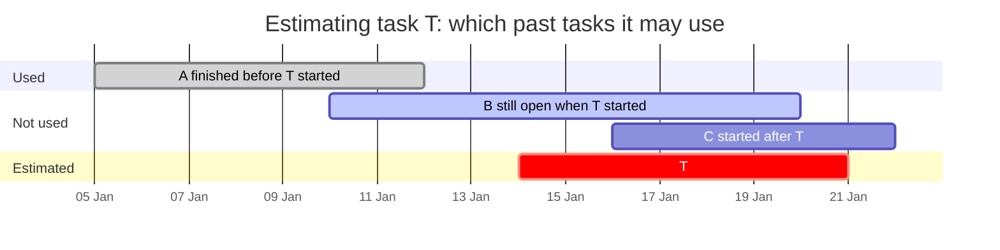
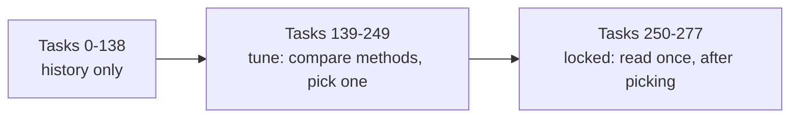
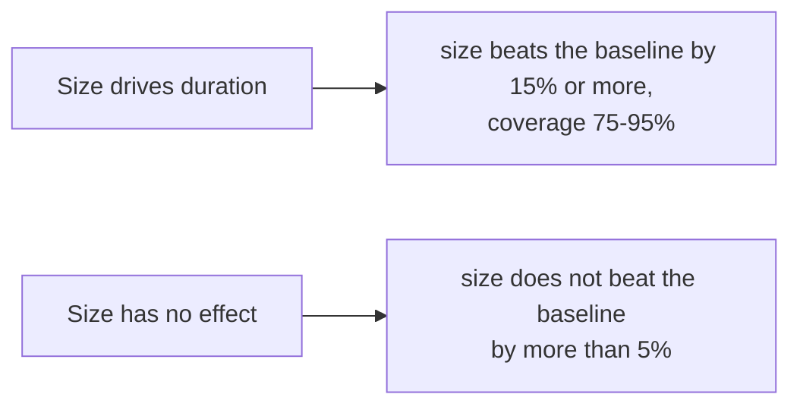
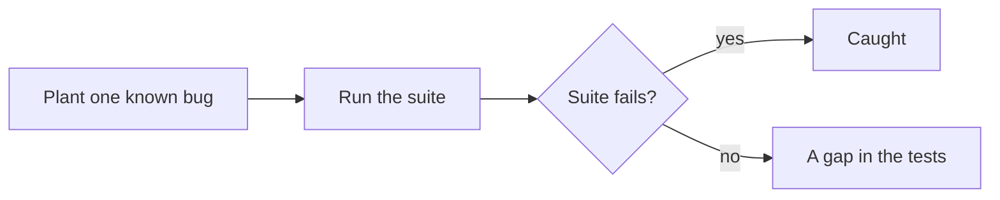

# How cc-estimate works

cc-estimate answers one question: **how long will this task take here?** It answers from your
own repository's history, as a range, and keeps score of how good those ranges turn out to be.

Every output below comes from a made-up history of 300 tasks by three people. Recreate it with:

```bash
python3 examples/sample_history.py data/sample.tasks.jsonl
```

## The pipeline

1. **Build tasks.** One task is one piece of work: a tracker key in commit messages (`git-tasks`),
   or the pull requests that close the same issue (`fetch`, `links`, `tasks`). Bots, release
   branch cherry-picks and automation are dropped.
2. **Measure cycle time in working hours.** From the first commit (or the PR opening, if earlier)
   to the last merge, counting only Monday to Friday, 09:00–18:00 in your timezone. Absence days
   and blocked periods are subtracted.
3. **Backtest.** Replay the history in order. Each past task is estimated using only tasks that
   had finished before it started, and every method is scored against plain baselines.
4. **Estimate.** For a new task of a given size, print the 80% range of similar finished tasks,
   next to the range you would get without a size.
5. **Log and score.** `--log` records the estimate. `score` later compares it with what happened.

For example, a task whose first commit lands on Friday at 15:00 and whose PR merges on Monday at
11:00 took 68 hours on the clock but 5 working hours:



A task file is one JSON object per line:

```json
{"id": "DEMO-2", "title": "chore: tidy", "author": "carol", "labels": [], "start": "2026-01-05T17:00:00+00:00", "end": "2026-01-09T23:38:43.571697+00:00", "lines": 3028, "code_lines": 1556, "test_lines": 1472, "doc_lines": 0, "excluded": {}}
```

## Reading `backtest`

The backtest walks the history in start order. For each task it builds the range a method would
have given that day, then checks where the real duration landed. Only tasks that had already
finished count as history:



The tasks are then split in three, in time order:



```text
dropped 22 tasks starting after 2026-06-04 (right-censoring)
tasks with blocked or absence time removed: 0
test-heavy tasks (tests over 3x product code): 38
tasks: 278  tune: [139,250)  locked: [250,278)  level=0.8  locked from 2026-05-19
  XS n=  55  business hours p10=   0.0 p50=   9.0 p90=  18.0
  S  n=  56  business hours p10=   2.5 p50=   9.0 p90=  18.8
  M  n=  58  business hours p10=   6.6 p50=  18.0 p90=  27.0
  L  n=  56  business hours p10=  20.3 p50=  45.0 p90=  70.4
  XL n=  53  business hours p10=  63.0 p50=  97.0 p90= 134.2
```

The first 139 tasks are history only. Tasks 139–249 are the **tune** slice, where you may compare
and pick methods. The last 28 are **locked**: look at them once, after choosing. The size table
shows the spread inside each size (size is changed product-code lines, tests and docs not counted:
XS under 50, S under 300, M under 1,500, L under 5,000). The test-heavy count is the tasks whose test
lines exceed three times their product-code lines; they are sized by their code, not their tests. A size with fewer than five tasks, or fewer than three people, shows only its count.

```text
== LOCKED · all tasks ==
  method                         n  cover  width_h medAE_h  winkler fallbk
  baseline: repo                28   0.86     87.6    10.0    130.3   0.00
  baseline: trailing 30d        28   0.82     94.7    12.5    132.4   0.00
  baseline: same author         28   0.86     95.0    12.3    121.2   0.00
  size                          28   0.89     20.7     7.0     48.1   0.00
  size+kind                     28   0.71     21.2     8.0     57.7   0.00
```

- **cover**: how often the real duration landed inside the range. Aim for about 0.80.
- **width_h**: the median range width in working hours. Narrower is more useful.
- **medAE_h**: the median distance between the middle of the range and the real duration.
- **winkler**: width plus a penalty for each hour a miss falls outside the range. One number for
  "narrow and right"; lower is better.
- **fallbk**: how often a method had too few matching tasks and fell back to a simpler one.

Here `size` cuts the Winkler score of every baseline by more than half at similar coverage, so on this
history the size is worth giving. On your history it may not be; the table tells you. Methods
that need `classify` output (approvals, test suites) only appear when you pass `--profiles`.

## Reading `estimate`

```text
$ cc-estimate estimate --size L --text "add CSV export"
Size L: 56 finished tasks in history (data up to 2026-06-25).
80% range: 20.3-70.4 work hours (2.3-7.8 working days), median 45.0 h (5.0 d).
Without a size: 4.8-94.8 h.
```

Read it as: eight in ten L tasks here finished in 2.3 to 7.8 working days. "Without a size" is the
range for any task; the gap between the two lines is what the size buys you. When a size has fewer
than five finished tasks, `estimate` says "Not enough history for size L" and prints only the
size-blind range. Tasks that started in the last 21 days are left out, because only the quick
ones among them have finished.

With a `classifier` in the config, `--paths` adds what the change will go through, for example
which approval groups and test suites the paths trigger. That is context; it does not change the
range.

## Logging and scoring

`estimate --log --issue 123` appends the range to `data/estimates.jsonl` with your login. After the
work merges, `score` finds its real cycle time and reports how many of your estimates landed in
their range, and whether your size call did better than the size-blind range. It only ever shows
your own estimates.

## How it is tested

- **Unit tests** pin each rule with small hand-made inputs: working hours across weekends, daylight
  saving and absence; blocked time counted once when spans overlap; grouping PRs into tasks; where
  a git-only task ends; the coverage, width and Winkler numbers worked out by hand.
- **No look-ahead.** Two tests check that an estimate cannot see the future: changing the outcome of
  any task that had not finished when the estimated one started leaves the estimate unchanged.
- **Signal and no signal.** On generated histories where size drives duration, `size` must beat the
  repo baseline's Winkler score by at least 15% and cover 75–95%, across five random seeds. On
  histories where size has no effect, `size` must not beat the baseline by more than 5%. A method
  that always wins, or never does, fails one of the two.
- **Privacy.** Every command that runs offline is run on a three-person history and fails if
  another person's login appears. Small groups are hidden in `summary` and `backtest`.
- **Mutation probe.** `python3 tests/mutation_probe.py` plants 28 known bugs one at a time (a
  look-ahead leak, a dropped miss penalty, weekends counted as work, the wrong range level, and so
  on) and checks that the suite fails for each. A last, harmless change must pass, which shows the
  probe is not failing everything. All 28 are caught.
- **CI** runs the suite on Python 3.10, 3.12 and 3.13, installs the package from scratch, runs
  `init` and `git-tasks` from outside the source tree, and checks the plugin manifests.

Why the "80%" range covers about 89% here: in the generated histories about a quarter of all
durations are exactly 0 working hours (finished overnight or at a weekend) or exactly 9 (one full
working day). Those values often sit right on the 10th or 90th percentile, and a task on the edge
counts as inside the range. Nudging every duration by a thousandth of an hour breaks the ties and
brings coverage back to 79% (60 seeds, 10,080 estimates), so the percentile code is right. A test
checks that tie-broken coverage stays near 80%. A real history with many tasks finished outside
working hours will show the same effect; `backtest` reports the coverage you actually get.

Each generated world has a pass rule the other world would fail:



The mutation probe checks the tests themselves:



## Limits

- Cycle time mostly measures waiting (review, CI, queues), not effort. It is not a measure of a
  person, and the tool never compares people.
- The `size` rows in the backtest use the final size, as if you had named it perfectly at the
  start. Logged estimates measure how well you really name sizes.
- In a squash-merged history without merge commits, a git-only task ends at its last commit, which
  leaves out the wait for review.
- Size counts product-code lines only. Tests and docs are carried beside it; a task with tests over
  3x its code is flagged test-heavy. Task files from before this split have no `code_lines`; they
  load, sized by total lines, with a note on stderr.
