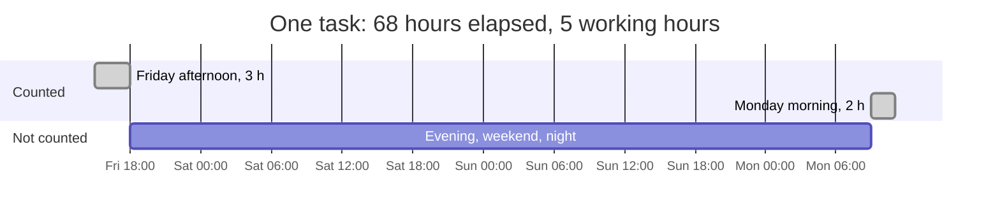
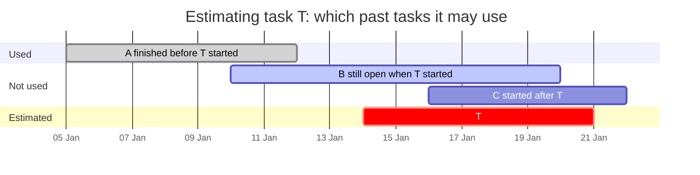
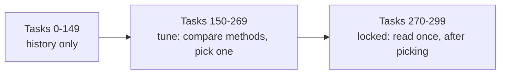
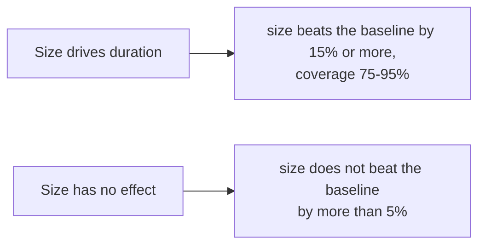
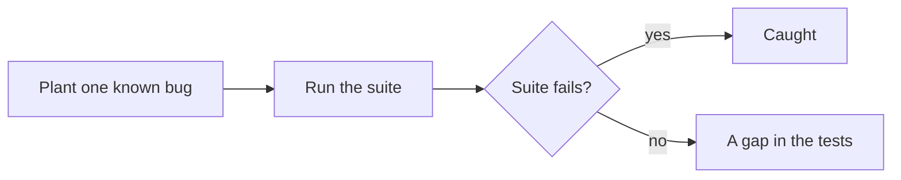

# How cc-estimate works

cc-estimate answers one question: **how long will this task take here?** It answers from your
own repository's history, as a range, and keeps score of how good those ranges turn out to be.

Every output below comes from a made-up history of 300 tasks by three people. Recreate it with:

```bash
python3 examples/sample_history.py data/sample.tasks.jsonl
```

## The pipeline

1. **Build tasks.** One task is one piece of work: a tracker key in commit messages (`git-tasks`),
   or the pull requests that close the same issue (`fetch`, `links`, `tasks`). Bots, release
   branch cherry-picks and automation are dropped.
2. **Measure cycle time in working hours.** From the first commit (or the PR opening, if earlier)
   to the last merge, counting only Monday to Friday, 09:00–18:00 in your timezone. Absence days
   and blocked periods are subtracted.
3. **Backtest.** Replay the history in order. Each past task is estimated using only tasks that
   had finished before it started, and every method is scored against plain baselines.
4. **Estimate.** For a new task of a given size, print the 80% range of similar finished tasks,
   next to the range you would get without a size.
5. **Log and score.** `--log` records the estimate. `score` later compares it with what happened.

For example, a task whose first commit lands on Friday at 15:00 and whose PR merges on Monday at
11:00 took 68 hours on the clock but 5 working hours:



A task file is one JSON object per line:

```json
{"id": "DEMO-2", "title": "feat: add", "author": "carol", "labels": [], "start": "2026-01-06T10:00:00+00:00", "end": "2026-01-14T14:17:18+00:00", "lines": 2803, "excluded": {}}
```

## Reading `backtest`

The backtest walks the history in start order. For each task it builds the range a method would
have given that day, then checks where the real duration landed. Only tasks that had already
finished count as history:



The tasks are then split in three, in time order:



```text
tasks: 300  tune: [150,270)  locked: [270,300)  level=0.8  locked from 2026-05-27
  XS n=  63  business hours p10=   0.0 p50=   9.0 p90=  18.0
  S  n=  57  business hours p10=   3.5 p50=  11.8 p90=  20.4
  M  n=  46  business hours p10=   9.0 p50=  19.0 p90=  32.0
  L  n=  70  business hours p10=  24.5 p50=  45.0 p90=  68.4
  XL n=  64  business hours p10=  70.9 p50= 115.0 p90= 173.8
```

The first 150 tasks are history only. Tasks 150–269 are the **tune** slice, where you may compare
and pick methods. The last 30 are **locked**: look at them once, after choosing. The size table
shows the spread inside each size (size is changed lines: XS under 50, S under 300, M under 1,500,
L under 5,000). A size with fewer than five tasks, or fewer than three people, shows only its count.

```text
== LOCKED · all tasks ==
  method                         n  cover  width_h medAE_h  winkler fallbk
  baseline: repo                30   0.73    101.9    18.0    181.0   0.00
  baseline: trailing 30d        30   0.80    134.1    18.0    155.3   0.00
  baseline: same author         30   0.73    101.2    17.9    162.4   0.00
  size                          30   0.83     47.7     9.0     85.2   0.00
  size+kind                     30   0.73     44.2     8.5     90.8   0.00
```

- **cover**: how often the real duration landed inside the range. Aim for about 0.80.
- **width_h**: the median range width in working hours. Narrower is more useful.
- **medAE_h**: the median distance between the middle of the range and the real duration.
- **winkler**: width plus a penalty for each hour a miss falls outside the range. One number for
  "narrow and right"; lower is better.
- **fallbk**: how often a method had too few matching tasks and fell back to a simpler one.

Here `size` halves the Winkler score of every baseline at about the same coverage, so on this
history the size is worth giving. On your history it may not be; the table tells you. Methods
that need `classify` output (approvals, test suites) only appear when you pass `--profiles`.

## Reading `estimate`

```text
$ cc-estimate estimate --size L --text "add CSV export"
Size L: 70 finished tasks in history (data up to 2026-07-09).
80% range: 24.5-68.4 work hours (2.7-7.6 working days), median 45.0 h (5.0 d).
Without a size: 6.0-118.5 h.
```

Read it as: eight in ten L tasks here finished in 2.7 to 7.6 working days. "Without a size" is the
range for any task; the gap between the two lines is what the size buys you. When a size has fewer
than five finished tasks, `estimate` says "Not enough history for size L" and prints only the
size-blind range. `estimate` applies the same two cuts as `backtest`. Tasks that started
before the earliest task end are left out, because only the long-lived ones of those are in the
file. Tasks that started within the last stretch of the data are left out too, because only the quick
ones among them have finished. That stretch is the 90th percentile of how long early tasks took, and
never less than 21 days.

With a `classifier` in the config, `--paths` adds what the change will go through, for example
which approval groups and test suites the paths trigger. That is context; it does not change the
range.

## Logging and scoring

`estimate --log --issue 123` appends the range to `data/estimates.jsonl` with your login. After the
work merges, `score` finds its real cycle time and reports how many of your estimates landed in
their range, and whether your size call did better than the size-blind range. It only ever shows
your own estimates.

## How it is tested

- **Unit tests** pin each rule with small hand-made inputs: working hours across weekends, daylight
  saving and absence; blocked time counted once when spans overlap; grouping PRs into tasks; where
  a git-only task ends; the coverage, width and Winkler numbers worked out by hand.
- **No look-ahead.** Two tests check that an estimate cannot see the future: changing the outcome of
  any task that had not finished when the estimated one started leaves the estimate unchanged.
- **Signal and no signal.** On generated histories where size drives duration, `size` must beat the
  repo baseline's Winkler score by at least 15% and cover 75–95%, across five random seeds. On
  histories where size has no effect, `size` must not beat the baseline by more than 5%. A method
  that always wins, or never does, fails one of the two.
- **Privacy.** Every command that runs offline is run on a three-person history and fails if
  another person's login appears. Small groups are hidden in `summary` and `backtest`.
- **Mutation probe.** `python3 tests/mutation_probe.py` plants 24 known bugs one at a time (a
  look-ahead leak, a dropped miss penalty, weekends counted as work, the wrong range level, and so
  on) and checks that the suite fails for each. A last, harmless change must pass, which shows the
  probe is not failing everything. All 24 are caught.
- **CI** runs the suite on Python 3.10, 3.12 and 3.13, installs the package from scratch, runs
  `init` and `git-tasks` from outside the source tree, and checks the plugin manifests.

Each generated world has a pass rule the other world would fail:



The mutation probe checks the tests themselves:



## Limits

- Cycle time mostly measures waiting (review, CI, queues), not effort. It is not a measure of a
  person, and the tool never compares people.
- The `size` rows in the backtest use the final size, as if you had named it perfectly at the
  start. Logged estimates measure how well you really name sizes.
- In a squash-merged history without merge commits, a git-only task ends at its last commit, which
  leaves out the wait for review.
- Size counts all changed lines, tests included. Splitting product code from tests is planned
  (see `docs/superpowers/specs/`).
