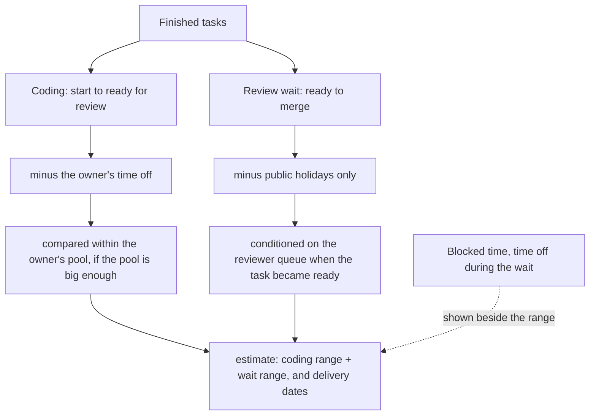

# Peer pools, time off, handovers and status signals — design

Status: approved 2026-10-28; revised 2026-11-11 after a second review and the split of cycle time
into coding and review wait. Builds on the v0.2 measure in
`2026-10-25-hardening-measure-advisor-design.md`.



## Two targets

Cycle time is split at the moment a task is ready for review.

- **Coding** is the owner's work: working hours from start to ready, minus the owner's time off.
  Pools, pace and handovers apply here.
- **Review wait** depends on reviewers, not the author: working hours from ready to merge, minus
  public holidays (`*` rows) and nothing personal. It is conditioned on the reviewer queue at
  ready time. Author or reviewer time off that overlaps the wait is shown beside the wait range.

Removing the author's time off from the wait would be wrong: an author on holiday while the PR sits
in review would teach the tool that review is instant.

**Owner.** The issue's assignee at the task's start, else the first PR's author. `author` keeps its
current meaning. Pools, pace and `score` key on the owner.

## Why

A range drawn from the whole repository mixes very different work: a backend change by someone who
owns that code and a first change in an unfamiliar area. A task's clock also keeps running through
time that says nothing about the work: a holiday, lost access, a sick day, a task changing hands.
Both make ranges wider than they need to be, and the second makes delivery dates wrong.

## What the tool protects, and what it does not

Anyone who can run `fetch` can read the same PR and issue timestamps from the GitHub API. The tool
cannot hide public repository data from them, and does not try. What it guarantees:

1. No command prints a per-person table, ranking or another person's login.
2. A range built from other people's work is released only under the rule in §1.
3. Time off is data the team supplies in a shared file, and anyone holding the file can read it.
   The guarantee is that no output reveals more than that file: no output prints any amount of
   time off, and counts of affected tasks are rounded down to tens.
4. No reason is stored with time off. "Sick" is health data and the tool has no use for it.

## 1. Peer pools ("people in the same role as me")

Config, one pool per role, team or area, chosen by the team:

```json
"pools": {"backend": ["login-a", "login-b", "login-c", "login-d"]},
"identities": {"login-a": ["a@example.com", "a@users.noreply.github.com"]}
```

`identities` maps each login to the git emails it commits with, so the git-only source can match
pool members. An email with no mapping belongs to no pool. The current user is the GitHub login, or
for the git source the login whose `identities` contain `git config user.email`.

**Release rule.** One rule for pools and for the size table: a range is shown only when, among
finished tasks of that size in the pool, excluding the user's own, there are at least 20 tasks from
at least three people, and no one person has more than 40% of them. The cap keeps any one person's
tasks from setting the edges of the range. Otherwise `estimate` uses the whole repository and says
the pool is too small. In `backtest`, `size+pool` falls back to `size`.

**Pools are fixed before any backtest.** Changing membership after reading a locked score is a
second look at the locked slice. `backtest` records a hash of the pool config with the tune run and
prints the locked block only while it is unchanged. Task counts are
printed rounded down to the nearest 10 ("40+ tasks"). The user's own tasks are left out of their pool range, so the
range describes the others and the user is compared with it, not with a mix that includes themself.

- **`estimate`** prints the pool range when released, otherwise the repository range, and always the
  size-blind range.
- **`score`** compares only the user's own logged estimates with their own actuals, as today. The
  log stores the pool range at log time (`pool_h`, null when withheld). After 15 or more finished
  estimates with a pool range, it adds one aggregate line: "Your actuals: 9 of 15 inside your
  pool's range, 2 faster, 4 slower." The range behind it always comes from at least three people,
  so it is a comparison with a group, never with one person. Fifteen estimates detect only large
  differences; the line says so. It replaces the earlier spec's blanket "no cross-person
  reporting" for this one aggregate only.
- **`backtest`** adds `size+pool` (each task estimated from its author's pool, by the same release
  rule, using only tasks finished before it started).

## 2. Time off and lost access

What exists: `absence` in the config (per login, and `*` for public holidays) as inclusive dates,
`--off` on `estimate`, and `excluded_labels` turned into excluded spans.

**The file.** `time_off_file` in the config points to a local, git-ignored CSV:

```csv
login,start,end
login-a,2026-11-03,2026-11-05
login-a,2026-11-10T14:00,2026-11-10T18:00
```

- A date is a whole working day; `end` is inclusive. A date-time is a span in the config
  `timezone`; `end` is exclusive.
- Overlapping rows are merged. A row whose login is not known, whose end is before its start, or
  that does not parse stops the run with the line number.
- `cc-estimate off add 2026-11-03..2026-11-05` appends rows for the current user only.

**Who reads it.** The file is shared by the team. `off add` appends the current user's rows only.
A row may not mix a date and a date-time. All times use the config `timezone`; a per-login timezone
is out of scope for now and the README says so.

**What it changes.** Time off is a calendar fact from an independent record, so the owner's time
off is removed from the coding target. Only public holidays are removed from the wait. Tasks that
started before the file's first row keep their holidays in; `backtest` prints the share of tune and
locked tasks that predate the file.

**Delivery dates.** The ranges stay in working hours. `estimate` also converts them into calendar
dates from today: the coding range skips weekends, public holidays and the user's own future time
off in the file plus `--off`; the wait range follows it and skips weekends and public holidays only.
"Likely done between 12 Nov and 19 Nov". `score` checks the actual against the same
working-hours range, so the forecast and the score use one definition.

**Output.** `backtest` keeps its count of tasks with any time removed, and prints nothing that
measures how much.

## 3. Handovers

**Source.** On GitHub, the closing issues' `AssignedEvent` and `UnassignedEvent`, with assignee
login and time, fetched with pagination (today's query reads ten events and only their times). On
Jira, the changelog's assignee field. The git-only source has no handover signal.

**Rules.**

- The owner at any moment is the issue's assignee. Several assignees at once are collaborators,
  not a handover. A task with several closing issues reads assignees, status events and markers
  from the lowest-numbered one, the same issue that keys the task.
- A task with no issue, or an unassigned one, has the first PR's author as its only owner.
- An assignee change after the task is ready for review is not a handover for the coding range.
- A handover is an assignee leaving while another person stays or arrives, after the task started.
- Different PR authors on one task are collaboration, not a handover.

**Use.** Tasks gain `handover: true` and `owners: [[login, from, to], ...]`. Each owner's time off is
removed only from their own segment. For prediction, the owner is the one known when the task
started (its first owner); that is who `size+pool` and pace use in `backtest`, so nothing after the
start leaks in. `backtest` reports coverage for handover tasks as a separate row.

## 4. Status signals

These are discretionary: a person decides to mark something blocked. So unlike time off, they are
**never removed from the target by default**. `estimate` reports them beside the range ("blocked
time on similar tasks: 0–6 h") and `backtest` prints that range. A team can opt in to removing a
signal from the target with `exclude_from_target`; `backtest` then prints the scores against the
original target as well, so the effect of the choice is visible.

- **Labels**: nothing discretionary is removed unless the team lists it in `exclude_from_target`.
  The built-in `blocked` label group becomes a reported signal. Configs that already set
  `excluded_labels` keep removal.
- **GitHub Projects status**: the issue timeline item `PROJECT_V2_ITEM_STATUS_CHANGED_EVENT`
  returns `createdAt`, `previousStatus` and `status` (checked on a public repository on 2026-10-28).
  Config names the project number and status values (`"project_status": {"project": 2,
  "blocked": ["Blocked", "On hold"]}`). Events are fetched with pagination; a span runs from moving
  into a listed status to the next event or the issue's close. Moves with `wasAutomated: true` are
  ignored. An issue with no events for that project contributes nothing. A recorded, synthetic GraphQL response is the test fixture.
- **Jira statuses**: as in the Jira design. Jira's changelog names people by account id, so
  `identities` takes an optional `jira` account id per login.
- **Comment markers**: issue comments only (not PR comments), first line exactly `/blocked` or
  `/unblocked`. A span runs from `/blocked` to the next `/unblocked` or the issue's close. A second
  `/blocked` while open is ignored; an `/unblocked` with no open span is ignored. Deleted comments are
  gone from the API and so do not count; edits are read as the current text. Free text is never
  parsed.

## How signals are judged

All methods are scored against one target: working hours minus time off. Signals, pools and
thresholds are compared and chosen on the **tune** slice. The chosen setup is then scored once on
the **locked** slice, which is never used for choosing. A signal stays on by default only if, on
the tune slice, it lowers the Winkler score with coverage between 70% and 90%, and the locked-slice
check agrees. Logged estimates are the evidence for real use.

## Evals

Simulator scenarios, added to the v0.2 table:

| Scenario | World | Must hold |
|---|---|---|
| pools | two pools of 4 people, one 2× slower at coding | `size+pool` beats `size` on the coding target, tune and locked; `estimate` uses the user's pool for coding only |
| tiny-pool | a pool of 3 where one person has 60% of tasks | `estimate` withholds the pool range and says why |
| time-off | 20% of tasks carry a holiday, some during review | coding ranges narrow against the shared target; wait ranges are unchanged by author time off; delivery dates skip the user's planned days for coding only |
| handover | 15% of tasks change assignee midway | flagged; each owner's time off applies only to their segment; prediction uses the first owner |
| markers | `/blocked` … `/unblocked` on issue comments | blocked-time range reported; target unchanged unless opted in |

Privacy tests:

- The every-command output test runs with pools, a time-off file and handovers. No other login,
  email or time-off amount appears.
- The release rule: pools that break it (fewer than 20 tasks, fewer than three people, one person
  over 40%) are withheld, and printed counts are rounded down to tens.

A user who edits the pool config and compares outputs can learn something about one member's
durations. Those durations come from public PR timestamps that the same user can already read
from the API, so the rule aims to stop accidental per-person reporting, not a determined reader of
public data. Time off is not public: only holders of the file can read it, and no output measures it.

## Out of scope

Guessing pools from data, parsing free text, storing reasons for time off, and any output of another
person's time off.
